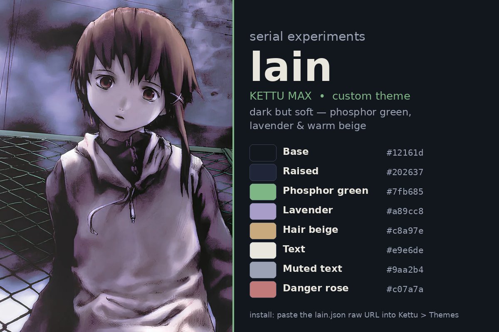

# kettu-max

The strongest Kettu-based modded Discord for iOS — custom theme, plugins and
extras for Discord 353.0 on iOS 27.2.1, loaded through
[dolanexeee/KettuTweak](https://github.com/dolanexeee/KettuTweak).

## Track 1 — Lain theme

**Install:** in Kettu, go to **Themes** and paste this URL:

```
https://dolanexeee.github.io/kettu-max/lain.json
```

(or the raw file: `https://raw.githubusercontent.com/dolanexeee/kettu-max/main/lain.json`)



### Palette — dark but soft, no neon

| Role | Colour | Hex |
|---|---|---|
| Base background | near-black blue-grey | `#12161d` |
| Raised / floating | blue-grey | `#202637` |
| Brand / accent | soft phosphor green | `#7fb685` |
| Links / secondary accent | lavender | `#a89cc8` |
| Warm accent | Lain hair beige | `#c8a97e` |
| Text | warm off-white | `#e9e6de` |
| Muted text | cool grey-lavender | `#9aa2b4` |
| Danger / critical | muted rose | `#c07a7a` |

Based on **Midnight Vencord** (refact0r) — every `semanticColors` (153) and
`rawColors` (188) key from the base is kept; values only were recoloured.
The base was taken as the union of the two shipped copies of that theme
(ThemeHub marketplace copy + upstream `discord-mobile-themes` copy) so no
key Discord 353.0 reads is missing.

### Lain images

All verified by eye as Lain Iwakura, official art:

| File | What it is | Source |
|---|---|---|
| `images/lain-wallpaper-portrait.jpg` | Portrait poster art — Lain under power lines, purple sky (630×1200) | Pinterest original |
| `images/lain-poster.webp` | Official landscape poster (1920×1080) | TMDB |
| `images/lain-wired.webp` | Lain in a white dress tangled in wires (1920×1080) | TMDB |

### About the background image

**The Kettu/Vendetta theme format (spec 2) has no background-image field.**
Both base theme files were checked: they contain only `semanticColors`,
`rawColors` and `plus` (icon/overlay colours) — no wallpaper key exists, so
no image can be embedded in `lain.json` itself.

To get Lain behind Discord:

1. **Phone wallpaper (easiest, always works):** save
   `images/lain-wallpaper-portrait.jpg` to the iPhone and set it as the
   wallpaper — Discord's own background stays the theme colour, Lain is
   behind the app.
2. **Profile banner (needs Nitro):** Discord Settings → Profiles → Banner →
   upload `images/lain-wired.webp` (1920×1080, ideal banner size).
3. **Avatar:** crop `images/lain-poster.webp` square and set it as the
   profile picture.

A chat-background image would need a custom Kettu plugin that injects a
background layer — that is a separate build, not part of the theme file.

## Files

```
lain.json                  — the theme (install URL above)
lain-preview.png           — palette + art preview
images/lain-wallpaper-portrait.jpg
images/lain-poster.webp
images/lain-wired.webp
theme/build_lain_theme.py  — reproducible recolour script (base -> lain.json)
theme/build_preview.py     — preview image generator
```

## Credits

- Base theme: Midnight Vencord by refact0r, via
  [ThemeHub](https://themes.kmmiio99o.workers.dev/theme/midnight-vencord-1756294017700)
  / [discord-mobile-themes](https://github.com/kmmiio99o/discord-mobile-themes)
- Art: *Serial Experiments Lain* (1998), Yoshitoshi ABe — official poster art
  via TMDB. Fan use only; not affiliated with the rights holders.
